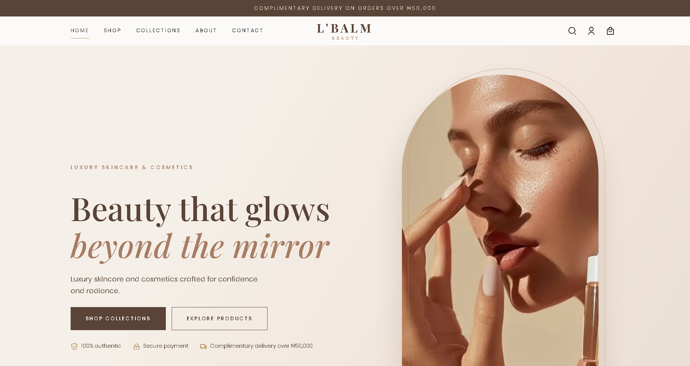

# L'Balm Beauty

A multi-page e-commerce front end for **L'Balm Beauty**, a luxury skincare and cosmetics brand. It covers the full shopping journey from browsing to checkout, with an elegant, mobile-first design.

**Live demo:** [add link here]



## Overview

The goal of this project was to design and build a polished, trustworthy online storefront using only HTML, CSS and vanilla JavaScript, with no frameworks or build tools. The design uses a warm neutral palette, Playfair Display for headings and Poppins for body text, with generous spacing and subtle motion to give a luxury feel.

## Features

- **15 pages:** home, shop, product, collections, about, contact, cart, checkout, FAQs, shipping, returns, order tracking, privacy policy, login and register
- **Data-driven catalogue:** every product is defined in one file (`js/products.js`), so adding or editing products needs no HTML changes
- **Shop tools:** category filtering, sorting, and live search with suggestions
- **Product pages:** image gallery, quantity selector, ingredients, how-to-use and caution details, and related products
- **Shopping bag:** persists between visits (localStorage), with quantity controls, a free-delivery threshold, delivery fee logic and promo codes
- **Checkout:** collects delivery details and sends a pre-filled order to WhatsApp
- **Responsive:** designed mobile-first with a slide-out menu on small screens and a full navigation bar on desktop
- **Accessibility:** semantic HTML, a skip-to-content link, visible focus states, labelled form fields and `prefers-reduced-motion` support

## Tech Stack

- HTML5
- CSS3 (custom properties, Grid, Flexbox)
- JavaScript (ES6+, no frameworks)
- [Remix Icon](https://remixicon.com/) and Google Fonts (Playfair Display, Poppins)

## Project Structure

` ` `
index.html            Redirects to the home page
html/                 All pages
css/
  lbalm_home.css      Global styles, header, hero, cards, footer
  pages.css           Shop, product, cart, checkout, forms, content pages
  login.css           Login and register (shared)
js/
  products.js         Product data and shared helpers
  cart.js             Shopping bag logic
  search-bar.js       Search with suggestions
  main.js             Navigation, header, scroll animations
  pages.js            Page-specific logic
assets/images/        Images
` ` `

## Getting Started

No installation is required.

1. Clone the repository

```bash
   git clone https://github.com/UniEK23/L-Balm-Beauty.git
   cd L-Balm-Beauty
```

2. Serve the folder with any static server, for example:

```bash
   python3 -m http.server 8000
```

or use the **Live Server** extension in VS Code. 3. Open `http://localhost:8000`.

## Customisation

- **Products:** edit `js/products.js` (name, price, size, ingredients, usage, image).
- **Product images:** add `img: "../assets/images/renders/your-image.png"` to a product. Optionally add a `gallery` array for extra product-page images. Images are 3D renders created in Blender.
- **Brand colours:** change the CSS variables at the top of `css/lbalm_home.css`.
- **Store settings:** the WhatsApp number, free-delivery threshold, delivery fee and promo codes are at the top of `js/products.js`.

## Current Status and Roadmap

This is a front-end project. The following are not yet connected:

- [ ] User accounts (login and register are front-end only)
- [ ] Online card payments (for example Paystack or Flutterwave)
- [ ] Backend or database for orders and inventory
- [ ] Contact form submission service
- [ ] Customer reviews from real orders

## Author

**Ekan Anaikot**: Web developer and 3D artist
[GitHub](https://github.com/UniEK23) · [LinkedIn](https://www.linkedin.com/in/ekan-anaikot-8a0623337)

## License

All rights reserved. © 2026 L'Balm Beauty. Contact the author for permission to reuse any part of this project.
